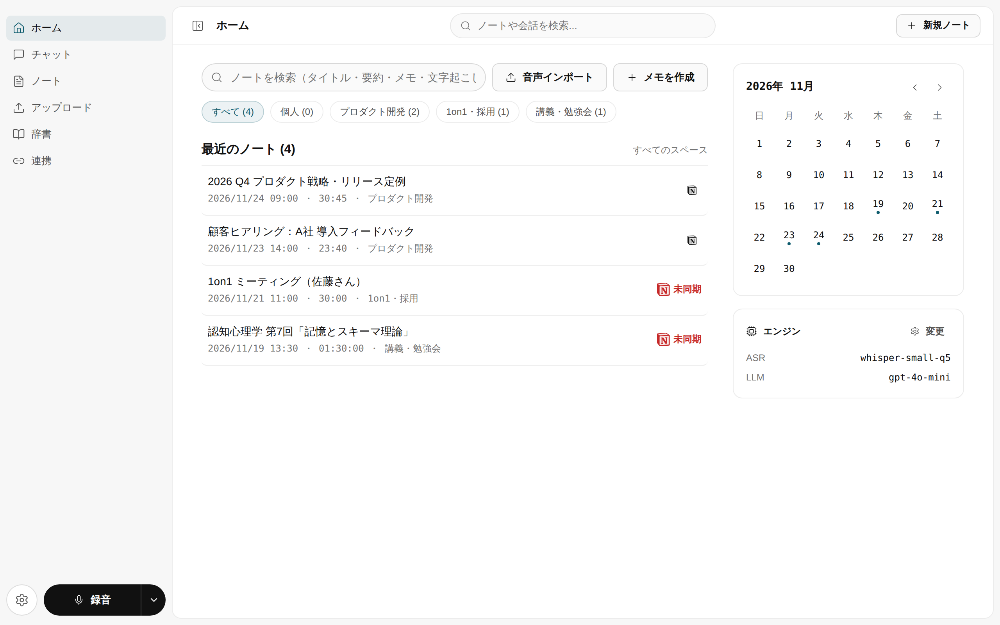
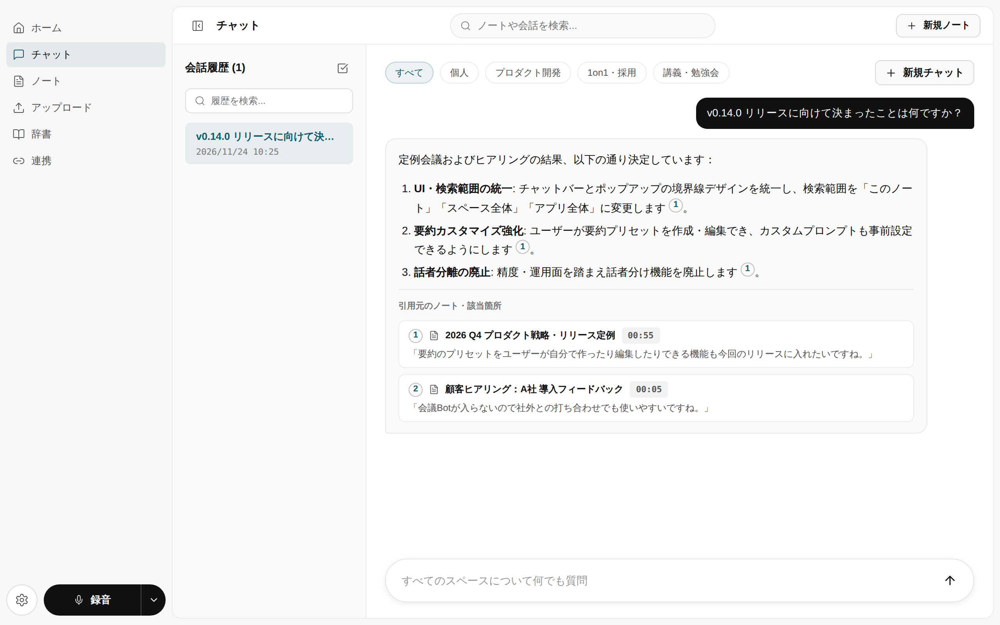

# Notelet

**Notelet** は、録音・文字起こしから AI 要約、根拠付きチャットによるノート横断検索・直接編集、Notion 双方向同期、各種外部ツール連携までを最短で行う**ローカルファースト**のデスクトップノートアプリです。

会議へ Bot として自動参加する方式は採用せず、PC 上の音声やマイク入力をローカルで安全に記録・処理します。

---

## 目次

- [スクリーンショット](#スクリーンショット)
- [対応 OS](#対応-os)
- [主な機能](#主な機能)
  - [1. 録音・会議検出・保護機能](#1-録音会議検出保護機能)
  - [2. ローカルファースト文字起こし](#2-ローカルファースト文字起こし)
  - [3. ノート編集・再生・エクスポート](#3-ノート編集再生エクスポート)
  - [4. AI 要約・カスタムプリセット・ライブアシスタンス](#4-ai-要約カスタムプリセットライブアシスタンス)
  - [5. AI チャットエージェント＆インライン引用](#5-ai-チャットエージェントインライン引用)
  - [6. データ移行（Granola インポート / Obsidian・JSON バックアップ）](#6-データ移行granola-インポート--obsidianjson-バックアップ)
  - [7. 外部サービス＆MCP 連携](#7-外部サービスmcp-連携)
- [対応音声認識（ASR）モデル](#対応音声認識asrモデル)
- [セットアップと使い方](#セットアップと使い方)
- [プライバシーとセキュリティ](#プライバシーとセキュリティ)
- [アーキテクチャ・ディレクトリ構成](#アーキテクチャディレクトリ構成)
- [開発・テスト・ビルド](#開発テストビルド)
- [既知の制限](#既知の制限)
- [クレジット](#クレジット)

---

## スクリーンショット

### ホーム画面（ノート一覧・スペース・カレンダー）
最近のノートやスペースごとの整理、カレンダーでの日付絞り込み、横断検索を一画面で行えます。



### ノート詳細（AI 要約・アクション項目・文字起こし）
録音・文字起こしの結果から AI 要約や決定事項、アクション項目を自動整理します。テンプレート（要約プリセット）の切り替えや Notion 同期もワンクリックです。


### ノート内チャットポップアップ（検索範囲の切り替え）
ノート下部のチャットバーから、「このノート」「スペース全体」「アプリ全体」を切り替えて即座に質問できます。


### 横断 AI チャット＆インライン引用
蓄積されたノート全体を横断して質問し、根拠となるノート・タイムスタンプへのクリック可能な引用バッジ付きで回答を得られます。



### AI 設定（カスタムプロンプト事前設定・要約プリセット編集）
AI プロバイダーの設定前でもカスタムプロンプトを事前保存でき、要約プリセットの作成・編集・既定設定を自由に行えます。


---

## 対応 OS

| OS | アーキテクチャ | 音声キャプチャ方式 | 備考 |
|---|---|---|---|
| **Windows 10 / 11** | x64 | Windows WASAPI（マイク／システム音声ループバック／両方） | インストーラー（NSIS / MSI）配布 |
| **macOS** | Apple Silicon（arm64） / Intel（x64） | CoreAudio（マイク／仮想デバイス経由システム音声／両方） | DMG / App バンドル配布 |
| **Linux** | x64 | マイク（ALSA / PulseAudio / PipeWire） | AppImage / deb / rpm 配布 |
| **Linux** | x86（32bit） | マイク（ALSA / PulseAudio / PipeWire） | AppImage 配布（i386版 GTK3 / WebKitGTK 4.1 が必要） |

---

## 主な機能

### 1. 録音・会議検出・保護機能
- **ワンクリック＆グローバルショートカット録音**: 画面上の録音ボタン、またはグローバルショートカット（既定: `CommandOrControl+Shift+R`）から即座に録音を開始できます。
- **柔軟な入力ソース選択**: マイク単体、PC システム音声単体、または「マイク＋システム音声」の同時録音に対応。外部 Bot を会議に招き入れる必要がありません。
- **会議アプリ検出**: Zoom / Microsoft Teams / Google Meet などの起動を検知して通知します。
- **録音中の安全設計**: 経過時間、入力デバイス、リアルタイム波形、無音検知、フローティングオーバーレイを表示。一時停止・再開に対応し、デバイス切断や権限エラー発生時も途中までの WAV 録音をローカルに保持します。

### 2. ローカルファースト文字起こし
- **完全ローカル ASR（既定）**:
  - **Whisper（`whisper.cpp`）** を標準搭載し、設定画面から Hugging Face の量子化モデル（Base / Small / Large v3 Turbo）をワンクリックでダウンロード可能。
  - **NVIDIA Parakeet（`sherpa-onnx` / TDT・CTC）** および **Qwen ASR** にも対応。
- **明示選択型のクラウド ASR（BYOK）**: OpenAI / Deepgram / Groq の各 API に対応。ユーザーが API キーを登録して明示的に選択した場合のみ送信し、**ローカルからクラウドへの自動フォールバックは一切行いません**。
- **音声ファイルのドラッグ＆ドロップ文字起こし**: 既存の録音ファイル（WAV / MP3 / M4A 等）をドロップして文字起こし・ノート化できます。

### 3. ノート編集・再生・エクスポート
- **構造化ノートエディタ**: 手入力メモ、AI 要約、決定事項、アクション項目、文字起こしタイムラインを統合管理。
- **音声同期再生**: セグメント単位の再生、アクティブ区間のハイライト、再生速度変更、無音スキップ機能を搭載。
- **一括編集・辞書**: タイトル自動生成、専門用語や固有名詞を補正するユーザー辞書に対応。
- **多彩なコピー・出力**: Markdown / プレーンテキスト / Slack / LINE 形式でのワンクリックコピー、OS 権限案内付きの貼り付け支援に対応。

### 4. AI 要約・カスタムプリセット・ライブアシスタンス
- **多様な LLM プロバイダ対応**: OpenAI / Anthropic / Gemini / Groq / OpenRouter / **Ollama（ローカル LLM）** に対応。
- **要約プリセットの自由な作成・編集**: 標準議事録、1on1・面談、講義・セミナー、ブレスト等のプリセットに加え、設定画面から独自の要約プリセットを作成・編集・既定設定できます。
- **カスタムプロンプトの事前設定**: AI プロバイダー設定前でも独自ルール・カスタムプロンプトを事前に保存でき、要約・チャット時に毎回適用されます。
- **リアルタイム AI アシスト**: 録音・会議中の文脈をもとにリアルタイムで論点や質問候補を補助します。

### 5. AI チャットエージェント＆インライン引用
- **柔軟な検索範囲（「このノート」「スペース全体」「アプリ全体」）**: `Ctrl+K` による高速検索に加え、ノート下部のチャットバーやチャットタブから「このノート」「スペース全体」「アプリ全体」を切り替えて対話形式で質問できます。
- **クリック可能なインライン引用バッジ**: 回答内の各主張の根拠となった引用元ノート・タイムスタンプに対し、文末へ番号バッジ（`[1]`, `[2]`）を自動付与。ホバーで抜粋プレビュー、クリックで該当ノートへ直接ジャンプできます。
- **チャットからの直接データ操作**: 自然言語の指示だけで以下の操作を自動実行します（ローカルフォールバック操作にも対応）。
  - ノートのタイトル変更・新規作成・削除
  - スペース（カテゴリ）の作成・名前変更・削除・ノートのスペース移動
  - タグの追加・削除
  - 要約・手入力メモの書き換え
  - アクション項目の追加

### 6. データ移行（Granola インポート / Obsidian・JSON バックアップ）
- **Granola からのシームレスな移行**:
  - Granola 公式 CSV エクスポート
  - ローカルキャッシュ（`cache-v3.json` 自動読み込み・二重 JSON / ProseMirror 変換対応）
  - Markdown（`.md`）および ZIP アーカイブ（`.zip`）
  - Granola API からの直接インポート
  - ※ すべて重複自動スキップ（デデュプリケーション）に対応しています。
- **Obsidian / Markdown 一括エクスポート**: 全ノートを YAML frontmatter 付きの Markdown ファイル群（ZIP）として出力できます。
- **JSON バックアップ＆復元**: アプリ全体のデータを JSON でエクスポートし、別環境への復元・マージが可能です。

### 7. 外部サービス＆MCP 連携
- **Notion 双方向同期**:
  - OAuth 2.0 または Internal Integration Token で接続し、保存先データベース／ページおよびプロパティ（タイトル・要約・日時等）をマッピング。
  - 既存ページ ID を保持して重複作成を防止し、Notion 側からの取り込み（Pull）にも対応。
- **カレンダー連携（ICS URL）**: Google Calendar や Outlook の非公開 ICS URL を購読し、会議予定・参加者を自動取得してノートと紐付けます。
- **Issue / タスク起票**: ノート内のアクション項目から **GitHub Issues / Linear / Jira** へワンクリックで Issue を起票できます。
- **Slack / 汎用 Webhook**: 要約やアクション項目を明示操作でチャネルへ共有します。
- **MCP サーバー同梱（`mcp-server/index.mjs`）**: Node.js 18+ で動作する標準入出力（stdio）ベースの読み取り専用 MCP サーバーを同梱。Claude Desktop や Cursor などの AI クライアントからローカルの Notelet ノートを検索・一覧取得・全文参照できます。

---

## 対応音声認識（ASR）モデル

| モデル / ランタイム | 言語 | 必要メモリ目安 | モデルサイズ目安 | ライセンス | 処理方式 |
|---|---|---|---|---|---|
| **Whisper Base** (`ggml-base.bin`) | 日本語・英語・多言語 | 約 500 MB | 142 MB | MIT (`whisper.cpp` / OpenAI Whisper) | 録音後処理 |
| **Whisper Small Q5_1** (`ggml-small-q5_1.bin`) | 日本語・英語・多言語 | 約 850 MB | 181 MB | MIT | 録音後処理 |
| **Whisper Large v3 Turbo Q5_0** | 日本語・英語・多言語 | 約 1.8 GB | 547 MB | MIT | 録音後処理 |
| **NVIDIA Parakeet TDT/CTC 0.6B 日本語** | 日本語（句読点対応） | 約 2.4 GB | 640 MB | CC-BY-4.0 (NVIDIA) / Apache-2.0 (`sherpa-onnx`) | 録音後処理 |
| **NVIDIA Parakeet TDT 0.6B v3** | 英語・欧州 25 言語 | 約 2.4 GB | 640 MB | CC-BY-4.0 / Apache-2.0 | 録音後処理 |
| **Qwen ASR** | 日本語・英語・多言語 | 環境依存 | モデル依存 | Apache-2.0 等 | 録音後処理 |
| **OpenAI / Groq / Deepgram Nova-2**（クラウド・BYOK） | 日本語・英語・多言語 | - | - | 商用 API | 録音後処理 |

---

## セットアップと使い方

### 1. ローカル音声認識ランタイムの準備
- **Whisper（推奨）**:
  1. `whisper.cpp` の `whisper-cli`（Windows では `whisper-cli.exe`）を `PATH` に通すか、アプリ内の **設定 ＞ ASRモデル** で実行ファイルのパスを指定します。
  2. 同画面から使いたいモデル（`ggml-base.bin` 等）をワンクリックでダウンロードします。
- **Parakeet**:
  1. `sherpa-onnx-offline` を導入してパスを指定します。
  2. `nvidia/parakeet-tdt_ctc-0.6b-ja` などの ONNX エクスポート済みモデルディレクトリをローカルモデルフォルダに配置します。

### 2. Notion 連携の設定
1. **設定 ＞ Notion・連携・MCP** を開きます。
2. Internal Integration Token を直接保存するか、OAuth 2.0（Client ID / Client Secret / Redirect URI）で認可してトークンを取得します。
3. 「保存先を検索」から保存先のデータベースまたはページを選択し、プロパティマッピング（タイトル・要約・日時等）を確認します。

### 3. MCP サーバーの設定（Claude Desktop / Cursor 等）
アプリ内の **設定 ＞ Notion・連携・MCP** から設定用 JSON をワンクリックで生成・コピーできます。手動設定する場合は以下のように `mcp-server/index.mjs` を指定します（Node.js 18 以上が必要）。

```json
{
  "mcpServers": {
    "notelet": {
      "command": "node",
      "args": ["/path/to/Notelet/mcp-server/index.mjs"],
      "env": {
        "NOTELET_DATA_PATH": "/path/to/notelet_data.json"
      }
    }
  }
}
```
※ `NOTELET_DATA_PATH` を省略した場合、OS 標準のアプリケーションデータディレクトリ配下にある `notelet_data.json` を自動検出します。アプリ本体の保存先を変更する場合は `NOTELET_DATA_DIR` を指定してください。旧バージョンのデータは初回起動時に自動で `Notelet` 配下へ移行されます。

---

## プライバシーとセキュリティ

- **ローカルファースト設計**: 文字起こし本文・手入力メモ・設定データはローカルの `notelet_data.json` に保存され、監査ログや解析イベントに本文を含めません。
- **資格情報の安全な保管**: API キーや OAuth トークンは OS 標準の資格情報ストア（Windows 資格情報マネージャ / macOS Keychain）および AES-256-GCM 暗号化ボールトに保存します。
- **録音データの暗号化と圧縮**: 保持する音声ファイルは **AES-256-GCM** で暗号化して保存でき、ストレージ節約のための再エンコード圧縮（16kHz モノラル）にも対応しています。
- **外部通信の透明性**: クラウド ASR を選択した場合は音声ファイルのみを、クラウド LLM を選択した場合はテキストデータ（文字起こし・メモ）のみを送信します。
- **コンプライアンス表記**: HIPAA、SOC 2、DPA 等の第三者認証・契約は取得していないため、準拠済みとは表示しません。

---

## アーキテクチャ・ディレクトリ構成

フロントエンドは **React 19 + TypeScript + Vite**、デスクトップバックエンドは **Tauri v2（Rust）** で構成されています。

```text
Notelet/
├── src/                        # React フロントエンド (UI / 状態管理 / インポート・エクスポート)
│   ├── components/             # 画面コンポーネント (録音 / エディタ / チャット / 設定 / 連携)
│   ├── lib/                    # Tauri IPC ラッパー, Granola 変換, ZIP / Markdown 出力
│   ├── styles/                 # Base Design System 準拠の CSS トークン・スタイル
│   └── test/                   # Vitest + React Testing Library テストスイート
├── src-tauri/                  # Tauri v2 / Rust バックエンド
│   ├── src/
│   │   ├── asr.rs              # Whisper / Parakeet / Qwen / クラウド ASR 実行エンジン
│   │   ├── audio.rs            # WASAPI / CoreAudio 録音・波形・暗号化・圧縮処理
│   │   ├── llm.rs              # 各種 LLM 呼び出し・要約・チャットエージェント・インライン引用
│   │   ├── notion.rs           # Notion OAuth / DB マッピング / 双方向同期
│   │   ├── integrations.rs     # ICS カレンダー / GitHub・Linear・Jira 起票 / Webhook
│   │   ├── secrets.rs          # OS Keychain / 資格情報マネージャ・暗号化ボールト
│   │   ├── storage.rs          # ローカル JSON 永続化・監査ログ
│   │   └── updater.rs          # GitHub Releases ベースのアプリ更新確認
│   └── tauri.conf.json         # Tauri ビルド・ウィンドウ・バンドル設定
├── mcp-server/
│   └── index.mjs               # Node.js 製 stdio MCP サーバー (読み取り専用ツール群)
└── .github/workflows/          # CI テスト (build.yml) & マルチプラットフォームリリース (release.yml)
```

---

## 開発・テスト・ビルド

### 前提条件
- **Node.js**: 18 以上（CI では Node 24 を使用）
- **Rust**: stable ツールチェーン
- **OS 別ビルドツール**:
  - **Windows**: Visual Studio Build Tools（「C++ によるデスクトップ開発」ワークロード）
  - **macOS**: Xcode Command Line Tools
  - **Linux (Debian/Ubuntu)**: `libwebkit2gtk-4.1-dev libappindicator3-dev librsvg2-dev patchelf libasound2-dev libssl-dev libsecret-1-dev`

### コマンド一覧

```bash
# 依存パッケージのインストール
npm install

# フロントエンドのビルド（TypeScript 型チェック + Vite バンドル）
npm run build

# ユニット・コンポーネントテスト実行（音声・外部 API はモック）
npm test -- --run

# Rust バックエンドのテスト実行
cargo test --manifest-path src-tauri/Cargo.toml

# Tauri デスクトップアプリの開発モード起動
npm run tauri dev

# リリース用インストーラー / パッケージのビルド
npm run tauri build
```

### MCP サーバー単体動作確認

```bash
printf '{"jsonrpc":"2.0","id":1,"method":"initialize","params":{}}\n{"jsonrpc":"2.0","id":2,"method":"tools/list","params":{}}\n' | node mcp-server/index.mjs
```

---

## 既知の制限

- **macOS でのシステム音声録音**: macOS の仕様上、PC のシステム音声単体またはマイクとの同時録音を行うには、BlackHole などの仮想オーディオデバイスの導入と複数出力装置の設定が必要です。
- **エンタープライズ向け中央管理機能**: SSO（SAML / OIDC）、SCIM プロビジョニング、集中監査 API、一元請求サーバーなどのサーバーサイド基盤は未実装です（ローカルファースト設計のため）。

---

## クレジット

- UI デザインの構成およびデザイントークン設計は、Uber Design による Figma コミュニティファイル「[Base Gallery](https://www.figma.com/community)」(CC BY 4.0) および Base Design System を参照しています。
