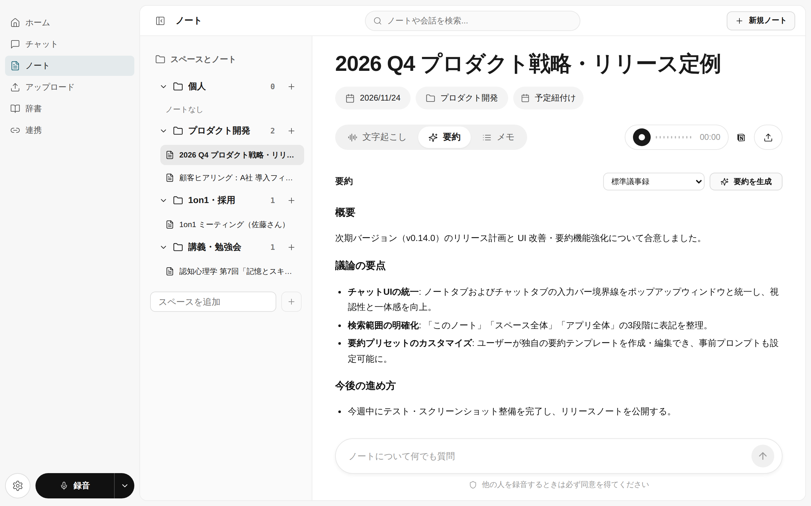
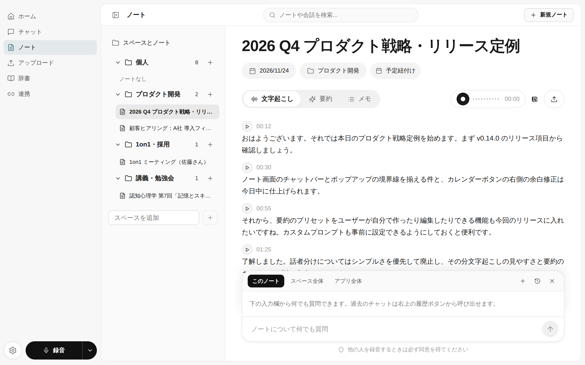
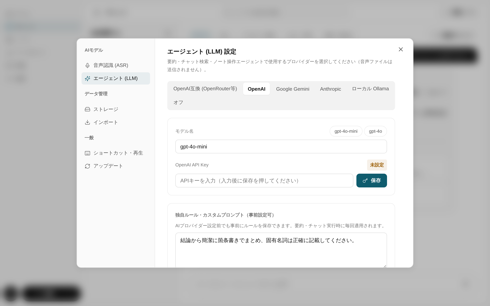

[English](README.md) | [日本語](README.ja.md)

# Notelet

**Notelet** is a **local-first** desktop note app that takes you from recording and transcription to AI summaries, evidence-backed chat across your notes, direct editing, two-way Notion sync, and integrations with other external tools in the shortest path possible.

It does not join meetings as a bot. Audio and microphone input on your PC are recorded and processed locally and safely.

The app UI ships in both English and Japanese; English is the default language. You can switch languages at any time in the app settings.

---

## Table of Contents

- [Screenshots](#screenshots)
- [Supported Platforms](#supported-platforms)
- [Key Features](#key-features)
  - [1. Recording, Meeting Detection and Safeguards](#1-recording-meeting-detection-and-safeguards)
  - [2. Local-First Transcription](#2-local-first-transcription)
  - [3. Note Editing, Playback and Export](#3-note-editing-playback-and-export)
  - [4. AI Summaries, Custom Presets and Live Assistance](#4-ai-summaries-custom-presets-and-live-assistance)
  - [5. AI Chat Agent and Inline Citations](#5-ai-chat-agent-and-inline-citations)
  - [6. Data Migration: Granola Import, Obsidian and JSON Backup](#6-data-migration-granola-import-obsidian-and-json-backup)
  - [7. External Services and MCP Integration](#7-external-services-and-mcp-integration)
- [Supported Speech Recognition (ASR) Models](#supported-speech-recognition-asr-models)
- [Setup and Usage](#setup-and-usage)
- [Privacy and Security](#privacy-and-security)
- [Architecture and Directory Layout](#architecture-and-directory-layout)
- [Development, Testing and Build](#development-testing-and-build)
- [Known Limitations](#known-limitations)
- [Credits](#credits)

---

## Screenshots

### Home (note list, spaces, calendar)
Review recent notes, organize them by space, filter by date on the calendar, and run cross-note search from a single screen.


### Note detail (AI summary, action items, transcript)
Recordings and transcripts are automatically turned into AI summaries, decisions, and action items. Switching summary presets or syncing to Notion takes a single click.



### In-note chat popup (switchable search scope)
From the chat bar at the bottom of a note, switch between "This note", "Entire space", and "Entire app" to ask questions immediately.



### Cross-note AI chat with inline citations
Ask questions across all of your accumulated notes and get answers with clickable citation badges pointing to the source notes and timestamps.


### AI settings (pre-configured custom prompts, summary preset editing)
You can save custom prompts before configuring an AI provider, and freely create, edit, and set defaults for summary presets.



---

## Supported Platforms

| OS | Architecture | Audio capture | Notes |
|---|---|---|---|
| **Windows 10 / 11** | x64 | Windows WASAPI (microphone / system audio loopback / both) | Installer distribution (NSIS / MSI) |
| **macOS** | Apple Silicon (arm64) / Intel (x64) | CoreAudio (microphone / system audio via a virtual device / both) | DMG / app bundle distribution |
| **Linux** | x64 | Microphone (ALSA / PulseAudio / PipeWire), system audio via enumerable monitor inputs | AppImage / deb / rpm distribution |
| **Linux** | x86 (32-bit) | Microphone (ALSA / PulseAudio / PipeWire), system audio via enumerable monitor inputs | AppImage distribution (requires i386 GTK3 / WebKitGTK 4.1) |
| **Android** | arm64 / armv7 / x86_64 (universal APK) | Microphone (AAudio) | APK distribution. Portrait uses the mobile UI, landscape uses the desktop UI |

---

### Checking Linux audio input

1. When using PulseAudio / PipeWire, confirm that an input named "Monitor of ..." exists as a recording source in your audio settings. On ALSA, check the available input devices.
2. Select a microphone in Notelet's recording settings and speak during the microphone test to confirm the input level changes.
3. To record system audio, choose "System audio", select the monitor input that appears, and check the waveform and the recording result while audio is playing.
4. If no inputs are enumerated, check your PipeWire / PulseAudio / ALSA input configuration. The recording log reports the host, device configuration, and number of samples received. The microphone test continuously displays the input level; if the level does not move, check the device and permission settings.

### Using the Android build

1. Download `Notelet_<VERSION>_android.apk` from Releases and install it on your device (you must allow installing apps from unknown sources).
2. Grant the microphone permission requested on first launch. Android supports microphone recording only; system audio cannot be recorded.
3. In portrait orientation the app switches to a mobile UI (bottom tabs plus a record button); in landscape it runs the familiar desktop UI.
4. Locally executed transcription engines (such as whisper.cpp) are not available on Android. Go to Settings → Speech Recognition, choose "Cloud API", and register an API key.

### Registering the AppImage launcher on Chromebook / Linux

To add the app to your shelf manually, create an entry such as `~/.local/share/applications/notelet.desktop` and replace `Exec` and `Icon` with the actual paths. `StartupWMClass=notelet` links the window to the launcher entry.

```ini
[Desktop Entry]
Type=Application
Name=Notelet
Exec=/path/to/Notelet.AppImage
Icon=/path/to/Notelet.png
StartupWMClass=notelet
Terminal=false
Categories=Office;
```

## Key Features

### 1. Recording, Meeting Detection and Safeguards
- **One-click and global-shortcut recording**: Start recording instantly from the on-screen record button or a global shortcut (default: `CommandOrControl+Shift+R`).
- **Flexible input source selection**: Record the microphone alone, PC system audio alone, or both at the same time. No need to invite an external bot into your meetings.
- **Meeting app detection**: Detects when apps such as Zoom, Microsoft Teams, or Google Meet are launched and notifies you.
- **Safety while recording**: Shows elapsed time, the input device, a live waveform, silence detection, and a floating overlay. Supports pause and resume, and keeps the partial WAV recording locally if a device disconnects or a permission error occurs.

### 2. Local-First Transcription
- **Fully local ASR (default)**:
  - **Whisper (`whisper.cpp`)** ships built in, and quantized Hugging Face models (Base / Small / Large v3 Turbo) can be downloaded from the settings screen with one click.
  - Also supports **NVIDIA Parakeet (`sherpa-onnx` / TDT and CTC)** and **Qwen ASR**.
- **Explicitly opt-in cloud ASR (BYOK)**: Supports the OpenAI, Deepgram, and Groq APIs. Audio is sent only when you register an API key and explicitly select the service; there is **no automatic fallback from local to cloud**.
- **Drag-and-drop transcription of audio files**: Drop an existing recording (WAV / MP3 / M4A, etc.) to transcribe it and turn it into a note.

### 3. Note Editing, Playback and Export
- **Structured note editor**: Manage handwritten memos, AI summaries, decisions, action items, and the transcript timeline in one place.
- **Synced audio playback**: Segment-by-segment playback, highlighting of the active segment, playback speed control, and silence skipping.
- **Bulk editing and dictionaries**: Automatic title generation and a user dictionary that corrects technical terms and proper nouns.
- **Versatile copy and export**: One-click copy as Markdown / plain text / Slack / LINE, plus paste assistance with OS permission guidance.

### 4. AI Summaries, Custom Presets and Live Assistance
- **Support for many LLM providers**: OpenAI / Anthropic / Gemini / Groq / OpenRouter / **Ollama (local LLM)**.
- **Freely create and edit summary presets**: In addition to presets for standard meeting minutes, 1-on-1s and interviews, lectures and seminars, and brainstorming, you can create, edit, and set defaults for your own summary presets in the settings screen.
- **Pre-configured custom prompts**: Save your own rules and custom prompts even before configuring an AI provider; they are applied to every summary and chat request.
- **Real-time AI assistance**: Helps surface talking points and candidate questions in real time based on the context of the recording or meeting.

### 5. AI Chat Agent and Inline Citations
- **Flexible search scope ("This note", "Entire space", "Entire app")**: In addition to fast search with `Ctrl+K`, switch between "This note", "Entire space", and "Entire app" from the chat bar at the bottom of a note or from the chat tab to ask questions conversationally.
- **Clickable inline citation badges**: Every claim in an answer automatically gets a numbered badge (`[1]`, `[2]`) at the end of the sentence for the source note and timestamp it is based on. Hover for an excerpt preview, or click to jump straight to the note.
- **Direct data operations from chat**: Natural-language instructions alone trigger the following operations (local fallback actions are also supported):
  - Rename, create, and delete notes
  - Create, rename, and delete spaces (categories), and move notes between spaces
  - Add and remove tags
  - Rewrite summaries and handwritten memos
  - Add action items

### 6. Data Migration: Granola Import, Obsidian and JSON Backup
- **Seamless migration from Granola**:
  - Granola's official CSV export
  - Local cache (`cache-v3.json` is loaded automatically; double-encoded JSON and ProseMirror conversion are supported)
  - Markdown (`.md`) and ZIP archives (`.zip`)
  - Direct import from the Granola API
  - ※ All import paths support automatic duplicate skipping (deduplication).
- **Bulk Obsidian / Markdown export**: Export all notes as a set of Markdown files with YAML frontmatter (ZIP).
- **JSON backup and restore**: Export all app data as JSON and restore or merge it into another environment.

### 7. External Services and MCP Integration
- **Two-way Notion sync**:
  - Connect via OAuth 2.0 or an Internal Integration Token, then map the destination database or page and its properties (title, summary, date and time, etc.).
  - Keeps existing page IDs to prevent duplicate creation, and also supports pulling changes from Notion.
- **Calendar integration (ICS URL)**: Subscribe to a private ICS URL from Google Calendar or Outlook to automatically fetch meeting events and attendees and link them to notes.
- **Issue and task filing**: File issues to **GitHub Issues / Linear / Jira** from action items in a note with one click.
- **Slack and generic webhooks**: Share summaries and action items to a channel through an explicit action.
- **Bundled MCP server (`mcp-server/index.mjs`)**: A read-only, stdio-based MCP server that runs on Node.js 18+ ships with the app. AI clients such as Claude Desktop and Cursor can search, list, and read the full text of local Notelet notes.

---

## Supported Speech Recognition (ASR) Models

| Model / runtime | Languages | Typical memory | Typical model size | License | Processing mode |
|---|---|---|---|---|---|
| **Whisper Base** (`ggml-base.bin`) | Japanese, English, multilingual | ~500 MB | 142 MB | MIT (`whisper.cpp` / OpenAI Whisper) | Post-recording |
| **Whisper Small Q5_1** (`ggml-small-q5_1.bin`) | Japanese, English, multilingual | ~850 MB | 181 MB | MIT | Post-recording |
| **Whisper Large v3 Turbo Q5_0** | Japanese, English, multilingual | ~1.8 GB | 547 MB | MIT | Post-recording |
| **NVIDIA Parakeet TDT/CTC 0.6B Japanese** | Japanese (punctuation aware) | ~2.4 GB | 640 MB | CC-BY-4.0 (NVIDIA) / Apache-2.0 (`sherpa-onnx`) | Post-recording |
| **NVIDIA Parakeet TDT 0.6B v3** | English and 25 European languages | ~2.4 GB | 640 MB | CC-BY-4.0 / Apache-2.0 | Post-recording |
| **Qwen ASR** | Japanese, English, multilingual | Depends on setup | Depends on model | Apache-2.0, etc. | Post-recording |
| **OpenAI / Groq / Deepgram Nova-2** (cloud, BYOK) | Japanese, English, multilingual | - | - | Commercial API | Post-recording |

---

## Setup and Usage

### 1. Preparing the local speech recognition runtime
- **Whisper (recommended)**:
  1. Put `whisper-cli` from `whisper.cpp` (on Windows, `whisper-cli.exe`) on your `PATH`, or specify the executable path under **Settings > ASR Models** in the app.
  2. Download the model you want to use (`ggml-base.bin`, etc.) from the same screen with one click.
- **Parakeet**:
  1. Install `sherpa-onnx-offline` and specify its path.
  2. Place an ONNX-exported model directory such as `nvidia/parakeet-tdt_ctc-0.6b-ja` in your local model folder.

### 2. Configuring the Notion integration
1. Open **Settings > Notion, Integrations, MCP**.
2. Either save an Internal Integration Token directly, or authorize with OAuth 2.0 (Client ID / Client Secret / Redirect URI) to obtain a token.
3. Use "Search destinations" to select the destination database or page, then confirm the property mapping (title, summary, date and time, etc.).

### 3. Configuring the MCP server (Claude Desktop, Cursor, etc.)
You can generate and copy the configuration JSON with one click from **Settings > Notion, Integrations, MCP** in the app. To configure it manually, point to `mcp-server/index.mjs` as shown below (requires Node.js 18 or later).

```json
{
  "mcpServers": {
    "notelet": {
      "command": "node",
      "args": ["/path/to/Notelet/mcp-server/index.mjs"],
      "env": {
        "NOTELET_DATA_PATH": "/path/to/notelet_data.json"
      }
    }
  }
}
```
※ If `NOTELET_DATA_PATH` is omitted, `notelet_data.json` is detected automatically inside the OS's standard application data directory. To change where the app itself stores data, set `NOTELET_DATA_DIR`. Data from older versions is migrated automatically into the `Notelet` directory on first launch.

---

## Privacy and Security

- **Local-first design**: Transcripts, handwritten memos, and settings are stored in the local `notelet_data.json`, and their contents are never included in audit logs or analytics events.
- **Secure credential storage**: API keys and OAuth tokens are stored in the OS's native credential store (Windows Credential Manager / macOS Keychain) and in an AES-256-GCM encrypted vault.
- **Encryption and compression of recordings**: Retained audio files can be stored encrypted with **AES-256-GCM**, and re-encoding compression (16 kHz mono) is available to save storage.
- **Transparent external communication**: If you choose cloud ASR, only the audio file is sent; if you choose a cloud LLM, only text data (transcripts and memos) is sent.
- **Compliance statements**: Third-party certifications and agreements such as HIPAA, SOC 2, and DPAs have not been obtained, so the app does not claim compliance with them.

---

## Architecture and Directory Layout

The frontend is built with **React 19 + TypeScript + Vite**, and the desktop backend with **Tauri v2 (Rust)**.

```text
Notelet/
├── src/                        # React frontend (UI / state management / import & export)
│   ├── components/             # Screen components (recording / editor / chat / settings / integrations)
│   ├── lib/                    # Tauri IPC wrappers, Granola conversion, ZIP / Markdown output
│   ├── styles/                 # CSS tokens and styles following the Base Design System
│   └── test/                   # Vitest + React Testing Library test suite
├── src-tauri/                  # Tauri v2 / Rust backend
│   ├── src/
│   │   ├── asr.rs              # Whisper / Parakeet / Qwen / cloud ASR execution engines
│   │   ├── audio.rs            # WASAPI / CoreAudio recording, waveform, encryption, compression
│   │   ├── llm.rs              # LLM calls, summaries, chat agent, inline citations
│   │   ├── notion.rs           # Notion OAuth / DB mapping / two-way sync
│   │   ├── integrations.rs     # ICS calendar / GitHub, Linear, Jira filing / webhooks
│   │   ├── secrets.rs          # OS Keychain / Credential Manager and encrypted vault
│   │   ├── storage.rs          # Local JSON persistence and audit logging
│   │   └── updater.rs          # Update checks based on GitHub Releases
│   └── tauri.conf.json         # Tauri build, window, and bundle configuration
├── mcp-server/
│   └── index.mjs               # Node.js stdio MCP server (read-only tools)
└── .github/workflows/          # CI tests (build.yml) and multi-platform releases (release.yml)
```

---

## Development, Testing and Build

### Prerequisites
- **Node.js**: 18 or later (CI uses Node 24)
- **Rust**: stable toolchain
- **OS-specific build tools**:
  - **Windows**: Visual Studio Build Tools (the "Desktop development with C++" workload)
  - **macOS**: Xcode Command Line Tools
  - **Linux (Debian/Ubuntu)**: `libwebkit2gtk-4.1-dev libappindicator3-dev librsvg2-dev patchelf libasound2-dev libssl-dev libsecret-1-dev`

### Command reference

```bash
# Install dependencies
npm install

# Build the frontend (TypeScript type check + Vite bundle)
npm run build

# Run unit and component tests (audio and external APIs are mocked)
npm test -- --run

# Run the Rust backend tests
cargo test --manifest-path src-tauri/Cargo.toml

# Start the Tauri desktop app in development mode
npm run tauri dev

# Build release installers / packages
npm run tauri build

# Build the Android APK (requires Android SDK / NDK / JDK 17+)
npx tauri android build --apk
```

### Verifying the MCP server on its own

```bash
printf '{"jsonrpc":"2.0","id":1,"method":"initialize","params":{}}\n{"jsonrpc":"2.0","id":2,"method":"tools/list","params":{}}\n' | node mcp-server/index.mjs
```

---

## Known Limitations

- **System audio recording on macOS**: Due to macOS restrictions, recording PC system audio alone or together with the microphone requires installing a virtual audio device such as BlackHole and configuring a multi-output device.
- **Speech recognition on Android**: Because no local execution engine is bundled, transcribing recordings requires a cloud ASR API key. System audio recording is not supported.
- **Enterprise central management features**: Server-side infrastructure such as SSO (SAML / OIDC), SCIM provisioning, a centralized audit API, and a billing server is not implemented, by design as a local-first app.
- **Deprecation of the legacy brand (KoeNote) compatibility fallback**: The `KOENOTE_DATA_DIR` / `KOENOTE_MCP_SCOPE` environment variables and the migration fallbacks for `koenote_data.json` and the old keychain service name are scheduled for removal in **v1.0.0**.

---

## Credits

- The UI design structure and design token design reference the Figma community file "[Base Gallery](https://www.figma.com/community)" by Uber Design (CC BY 4.0) and the Base Design System.
